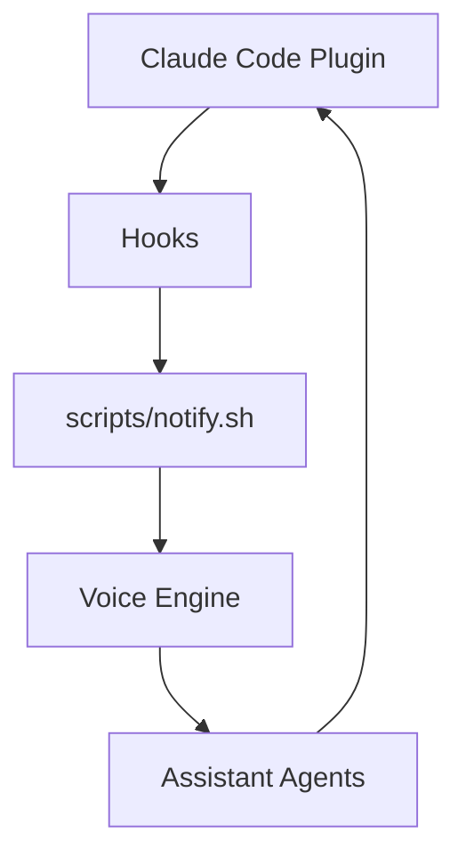

# coding-voice-assistant

<div align="center">


[](https://github.com/DenverCoder1/readme-typing-svg)

[](https://github.com/kubouchiyuya)
[](https://consulting-payment-tool.vercel.app)

</div>

---

## What This Does

This is the plugin edition of the voice-guided coding assistant. It gives Claude Code voice-aware feedback without requiring a separate MCP server.

The design goal is simple: keep the workflow light, reduce setup friction, and still let the assistant speak when it matters.

---

## ✨ Features

| Feature | Description |
|---|---|
| Plugin workflow | Hooks-based integration with Claude Code |
| No MCP required | Smaller operational footprint |
| Voice guidance | Spoken prompts and updates |
| Non-engineer friendly | Clear setup steps and plain-language explanations |
| Local-first | Can run with local voice tooling |

---

## 🚀 Quick Start

```bash
cd ~/Projects
git clone https://github.com/kubouchiyuya/coding-voice-assistant.git
cd coding-voice-assistant
./scripts/settings.sh
```

---

## 🏗️ Architecture



---

## 🛠️ Tech Stack


---

## 👤 Author

<div align="center">

| | |
|---|---|
| **Yuya Kubouchi (MASA2 / MASA Sub)** | Beauty Salon Owner → AI Architect |
| Location | Osaka, Japan |
| System | AKATSUKI / Miyabi Society |
| Identity | AI × Beauty Industry × Non-Engineer |

</div>
