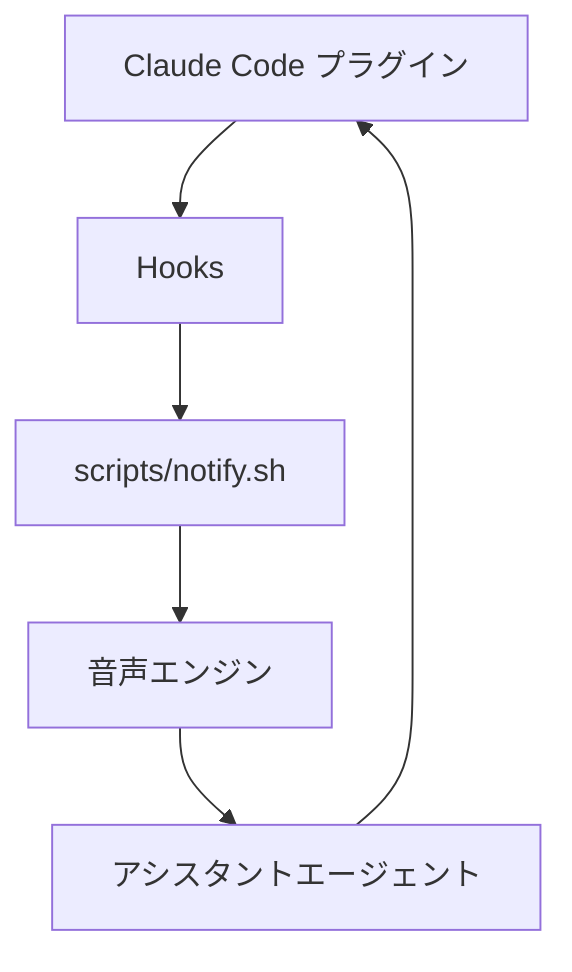

# coding-voice-assistant

<div align="center">


[](https://github.com/DenverCoder1/readme-typing-svg)

[](https://github.com/kubouchiyuya)
[](https://consulting-payment-tool.vercel.app)

</div>

---

## このツールでできること

このリポジトリは、音声付きコーディングアシスタントのプラグイン版です。Claude Code に直接つなぐので、別の MCP サーバーを立てずに音声通知を使えます。

セットアップを軽くしつつ、必要なときだけ声で進行を知らせることを目的にしています。

---

## ✨ 機能

| 機能 | 説明 |
|---|---|
| プラグイン構成 | Claude Code Hooks を利用した連携 |
| MCP 不要 | 運用の手数が少ない |
| 音声ガイド | 音声で進行や完了を通知 |
| 非エンジニア向け | 平易な導入説明 |
| ローカル優先 | 手元の音声環境で運用可能 |

---

## 🚀 はじめかた

```bash
cd ~/Projects
git clone https://github.com/kubouchiyuya/coding-voice-assistant.git
cd coding-voice-assistant
./scripts/settings.sh
```

---

## 🏗️ アーキテクチャ



---

## 🛠️ 技術スタック


---

## 👤 作者

<div align="center">

| | |
|---|---|
| **窪内裕也（MASA2 / MASA サブ）** | 美容室オーナー → AI アーキテクト |
| 拠点 | 大阪 |
| 所属 | AKATSUKI / Miyabi Society |
| アイデンティティ | AI × 美容業界 × 非エンジニア |

</div>
